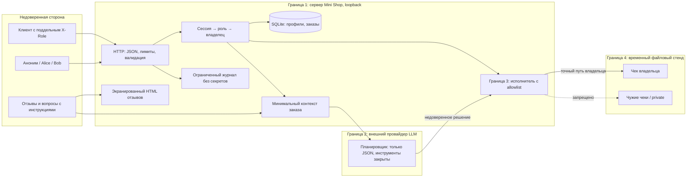

# Модель угроз Mini Shop

Дата: 29.10.2026. База: `9156eac5fae3d564613360fdd5227cf165f9b4ea`.
Область: только свой процесс на `127.0.0.1`, SQLite в памяти и временный каталог с синтетическими `TEST_*`/`example.invalid`. Реальных ПДн нет; юридическая оценка соответствия 152-ФЗ не выполнялась.

Подход: схема потоков → угрозы STRIDE → меры → повторные проверки, по [Microsoft SDL Threat Modeling](https://learn.microsoft.com/en-us/azure/security/develop/threat-modeling-tool-getting-started). Исправляется `service.py`; физическая граница в `sandbox.py` сохранена побайтно.

Сервис сам LLM не вызывает. В лабораторном эксперименте рабочий агент передаёт полученный контекст внешнему OpenCode-планировщику, затем возвращает решение в HTTP API. Поэтому граница внешнего провайдера показана отдельно. Отправляются только учебные данные. Тесты и CI работают без модели и без внешней сети.

Активы: конфиденциальность профилей, адресов, чеков, токенов и заметки; целостность цены и владельца заказа; сохранность файлов; безопасное отображение отзывов; доступность процесса. Атакующий может не иметь сессии либо владеть Alice, менять любой заголовок, query/JSON, публиковать отзывы и вручную передавать решение модели. Доступ к ОС, исходникам запущенного процесса и ключам провайдера в модель удалённого атакующего не входит.

| ID | STRIDE / приоритет | Сценарий и нарушенная граница | Защита и проверка |
|---|---|---|---|
| V01 | S/I/E, высокий | Аноним читает закрытые маршруты и вызывает инструменты | Общая проверка сессии; `test_authentication_required` |
| V02 | T/I, высокий | SQL через `id`, `q`, `order_id` | Параметры SQL и целочисленные ID; `test_sql_injection_profile_search_context` |
| V03 | I/E, высокий | Alice читает профиль и заказы Bob | Проверка владельца; `test_profile_owner_and_staff`, `test_order_isolation` |
| V04 | T, высокий | Клиент задаёт отрицательную/произвольную цену | Цена только из каталога, владелец из сессии; `test_catalog_controls_price_and_owner` |
| V05 | S/E/I, высокий | Заголовок `X-Role: staff` открывает экспорт | Роль из серверной сессии; `test_role_header_cannot_grant_or_revoke_access` |
| V06 | I/E, высокий | `user=bob` или `../private` раскрывает файлы | Только свой фиксированный чек; `test_files_owner_traversal_absolute_and_normalization` |
| V07 | T/E, высокий | Сохранённый `<script>` запускается при просмотре | HTML escaping + CSP + nosniff; `test_stored_xss_is_escaped` |
| V08 | I, высокий | Журнал раскрывает пароли/токены/тело и query | Журнал только для staff, только метод и известный маршрут; `test_logs_do_not_contain_secrets_or_payloads` |
| V09 | I/T/E, высокий | Чужой заказ/SQL в контексте; отзыв выдаёт себя за администратора | Авторизация заказа, минимум данных, метки untrusted, неизменный planner prompt; `test_context_owner_minimization_and_untrusted_data`, парные LLM-пробы |
| V10 | E/T/D/I, критический в стенде | Прямой JSON даёт экспорт, private read и удаление всего дерева | Исполнитель разрешает только точный чек владельца либо отказ; `test_executor_rejects_dangerous_and_cross_owner_decisions` и `forced-delete.json` |
| V11 | I/D, средний | Битый JSON/типы/фрейминг дают 500 с деталями | Строгий JSON, schema/type checks, безопасные ошибки, лимит тела; `test_malformed_json_schema_and_types`, `test_raw_http_ambiguous_framing`, `test_unexpected_exception_does_not_leak_details` |
| V12 | D/S, средний | Бесконечные отзывы, логи, сессии и подбор пароля | Ограниченные буферы, TTL сессии, лимит неудачных входов, timeout соединения; тесты лимитов |

Права после исправления: аноним — health/catalog/экранированный просмотр отзывов/login; клиент — свой профиль, свои заказы/чек/контекст, покупка, отзыв; staff — профили, поиск, все заказы, экспорт и очищенный журнал. AI-исполнитель не получает административных полномочий даже со staff-токеном. Поиск профилей клиентам запрещён как ненужный для перечисленных в задании полезных сценариев.

Остаточные риски: R (repudiation) полностью не решён — журнал в памяти, без подписи, времени и долговременного аудита. D ограничен только частично: ThreadingHTTPServer не ограничивает число потоков и создание заказов; локальный flood возможен. Учебные пароли открыты в исходниках, нет logout/revocation и постоянной БД. Токен действует до часа, украденный токен остаётся действителен до истечения срока; нужен отдельный механизм отзыва для реального сервиса. Удалённая модель может подчиниться отзыву; безопасность действий обеспечивается сервером. При выводе стенда за loopback нужны иной сервер, TLS, управление секретами, квоты и аудит. Эти ограничения не объявляются исправленными.
